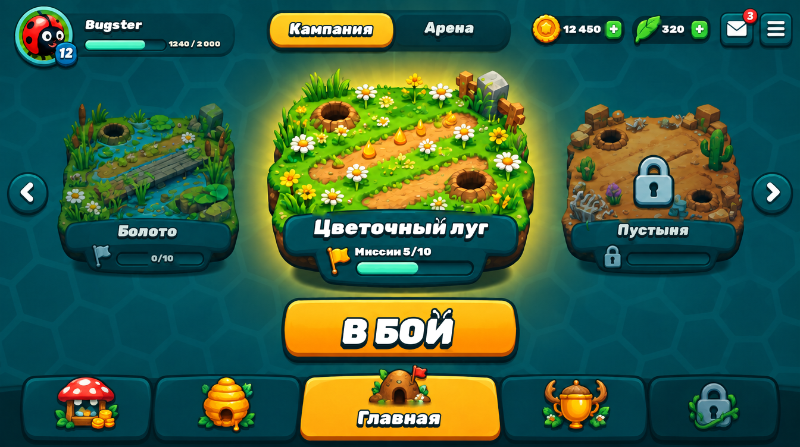
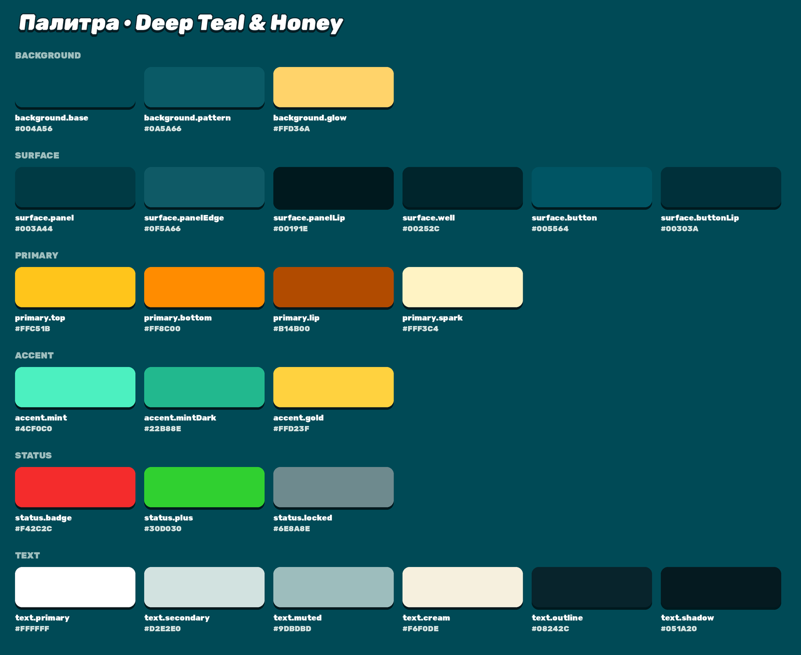
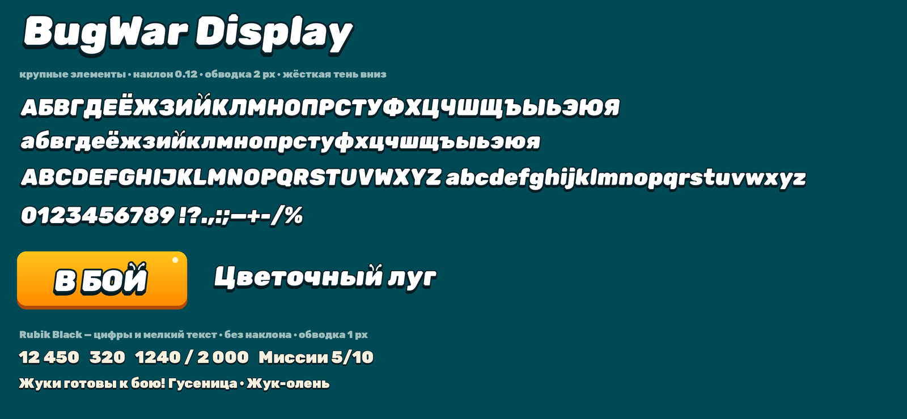

# BugWar — дизайн-система

Единые правила интерфейса мобильной игры **«Война букашек»** (BugWar Mobile, Unity 6, URP).
Все меню собираются по этим правилам. Документ живой: дорабатываем по мере работы над экранами.

**Версия:** 1.0 · **Палитра:** Deep Teal & Honey · **Ориентация:** горизонтальная (landscape)

---

## Что лежит в репозитории

| Путь | Что это |
|---|---|
| `fonts/BugWarDisplay-Regular.ttf` | наш шрифт для крупных элементов |
| `fonts/Rubik-Black.ttf` | шрифт для цифр и мелкого текста (основа нашего шрифта) |
| `fonts/OFL.txt` | лицензия шрифтов (SIL Open Font License 1.1) |
| `tokens/tokens.json` | **источник правды**: цвета, типографика, размеры, отступы |
| `unity/BugWarPalette.cs` | палитра для Unity (`BugWar.UI.BugWarPalette`) |
| `tools/bugfont.py` | генератор шрифта BugWar Display из Rubik Black |
| `tools/make_previews.py` | перерисовывает превью палитры и шрифта из `tokens.json` |
| `previews/` | превью: палитра, шрифт, главная с нашим шрифтом |
| `references/` | утверждённые концепты экранов |

---

## 1. Принципы

1. **Объём без глянца.** Никаких пластиковых бликов и толстых фасок. Поверхность — плоский цвет с лёгким вертикальным градиентом, тонкая светлая линия по верхнему краю (1–2 px) и тёмный **бортик** снизу (4–6 px). Единственный блик — маленькая точка в углу главной кнопки.
2. **Компактно и с воздухом.** Элементы небольшие, между ними ровные отступы по сетке (см. «Отступы»).
3. **Выпуклое = нажимается, утопленное = показывает.** Кнопки выпуклые с бортиком. Счётчики валют и прогресс-бары — тёмные утопленные «колодцы».
4. **Элементы выходят за рамки.** Иконки валют налезают на левый край своего колодца, значки уведомлений — на угол кнопки.
5. **Цвет означает смысл.** Мёд — главное действие и выбранное. Красный — только уведомления. Зелёный — только «+». Мята — прогресс. Всё остальное — спокойная бирюза.
6. **Фон не спорит с интерфейсом.** Тёмная бирюза, крупный узор сот низкого контраста, тёплое пятно света за главным объектом.
7. **Ничего не прыгает при переключении.** Верхняя панель, переключатель режимов, главная кнопка и нижние вкладки стоят на одних и тех же местах на всех экранах.

---

## 2. Цвета

| Токен | HEX | Где используется |
|---|---|---|
| `background.base` | `#004A56` | фон экранов |
| `background.pattern` | `#0A5A66` | линии узора сот на фоне |
| `background.glow` | `#FFD36A` | тёплое пятно за главным объектом (20–35%) |
| `surface.panel` | `#003A44` | плашки, панели, неактивные вкладки |
| `surface.panelEdge` | `#0F5A66` | светлая линия по верху панели |
| `surface.panelLip` | `#00191E` | бортик панели |
| `surface.well` | `#00252C` | утопленные счётчики и прогресс-бары |
| `surface.button` | `#005564` | второстепенные и иконочные кнопки |
| `surface.buttonLip` | `#00303A` | бортик второстепенной кнопки |
| `primary.top` → `primary.bottom` | `#FFC51B` → `#FF8C00` | главная кнопка, выбранная вкладка, активный режим |
| `primary.lip` | `#B14B00` | бортик главной кнопки |
| `primary.spark` | `#FFF3C4` | точка-блик в углу главной кнопки |
| `accent.mint` → `accent.mintDark` | `#4CF0C0` → `#22B88E` | прогресс (опыт, миссии) |
| `accent.gold` | `#FFD23F` | награды, кубки |
| `status.badge` | `#F42C2C` | значки уведомлений |
| `status.plus` | `#30D030` | кнопки «+» у валют |
| `status.locked` | `#6E8A8E` | замки, закрытое |
| `text.primary` | `#FFFFFF` | основной текст |
| `text.secondary` | `#D2E2E0` | неактивные вкладки, подписи |
| `text.muted` | `#9DBDBD` | второстепенное, закрытое |
| `text.cream` | `#F6F0DE` | мелкий текст на тёмном |
| `text.outline` | `#08242C` | обводка текста |
| `text.shadow` | `#051A20` | тень текста |

---

## 3. Шрифты

### BugWar Display — крупные элементы
Заголовки, кнопки, вкладки, названия локаций, имя игрока.

Это наш шрифт на основе **Rubik Black**, изменённый программно (`tools/bugfont.py`):
- **лёгкий «панцирь»** — внешние углы каждой буквы срезаны под 45°; размер среза 11% от высоты самой буквы, поэтому строчные не ломаются;
- **усики на «Й/й»** — вместо дужки два усика с шариками на концах;
- у «Б/б» верхний левый угол не срезается, иначе буква читается как «6».

Полная кириллица, латиница, цифры и знаки.

### Rubik Black — цифры и мелкий текст
Счётчики валют, опыт, прогресс миссий, подписи, описания. Без наклона.

### Оформление текста

| | BugWar Display | Rubik Black |
|---|---|---|
| Заливка | `text.primary` | `text.cream` / `text.primary` |
| Обводка | 2 px, `text.outline` | 1 px, `text.outline` |
| Тень | жёсткая, строго вниз 3–6 px, без размытия, `text.shadow` | вниз 2 px |
| Наклон | 0.12 (≈ 7°) | нет |
| Размеры (Canvas 1920×1080) | hero 72 · кнопка 48 · заголовок 36 · вкладка 28 | счётчик 24 · подпись 20 · мелкий 16 |

### Настройка в Unity (TextMeshPro)
1. Скопировать `fonts/` в `Assets/UI/Fonts/`.
2. *Window → TextMeshPro → Font Asset Creator*: Source — шрифт, Sampling 90, Padding 9, Render Mode **SDFAA**, Atlas 1024×1024, Character Set — *Custom Characters* (вся кириллица, латиница, цифры, знаки). Для редких символов можно оставить режим **Dynamic**.
3. Материал-пресет для BugWar Display:
   - Face Color — белый;
   - **Outline**: Thickness ≈ 0.15, Color `#08242C`;
   - **Underlay**: Offset X 0, Y −0.8, Dilate 0.15, Softness 0, Color `#051A20` (это и есть жёсткая тень);
   - наклон: в Font Asset → *Font Weights* → **Italic Style = 12**, в тексте включить стиль *Italic*.
4. Для Rubik Black — отдельный пресет: Outline ≈ 0.08, Underlay Y −0.5, без Italic.

Обводка и тень делаются материалом, а не дополнительными объектами: на мобилках это практически бесплатно.

---

## 4. Формы, отступы, размеры

| | Значение |
|---|---|
| Радиус панели | 18 |
| Радиус кнопки | 16 |
| Плашки-«таблетки» (валюты, переключатель) | полное скругление |
| Бортик панели / кнопки | 5 / 6 |
| Светлая линия по верху | 2 |
| Шаг отступов | 4 · 8 · 16 · 24 · 32 · 48 |
| Минимальная зона нажатия | 96 (≈ 9 мм на телефоне) |

Значения в единицах Canvas при эталонном разрешении **1920×1080**, Canvas Scaler — *Scale With Screen Size*, режим *Expand*. Учитывать безопасную зону (вырезы экрана).

---

## 5. Элементы

- **Главная кнопка** («В БОЙ»): медовый градиент `primary.top → primary.bottom`, бортик `primary.lip`, точка-блик `primary.spark` в правом верхнем углу, текст BugWar Display. При нажатии кнопка опускается на высоту бортика, бортик исчезает.
- **Второстепенная кнопка** (стрелки, почта, меню): `surface.button` + `surface.buttonLip`, белая иконка.
- **Переключатель режимов** «Кампания / Арена»: строго по центру экрана, высота как у плашки игрока. Активный сегмент — медовый с бортиком, неактивный — утопленный `surface.panel`.
- **Плашка игрока** (левый верх): аватар в кольце, шестиугольный значок уровня на краю аватара, имя (BugWar Display), под ним полоса опыта в колодце (`surface.well`, заливка мятой) и цифры (Rubik Black).
- **Валюта** (правый верх): солнышко и листик. Утопленный колодец, иконка крупнее и налезает на левый край, число — Rubik Black, справа зелёный «+».
- **Карточка локации**: 3D-диорама, внизу плашка с названием (BugWar Display) и прогрессом миссий («Миссии 5/10» + полоса). Выбранная — крупнее, с мягким медовым свечением. Соседние — меньше, затемнены. Закрытая — замок, без счётчика.
- **Нижняя навигация**: 5 вкладок — Магазин, Улей, Главная, Испытания, закрытая. Выбранная — медовая и с подписью, остальные — только иконка на `surface.panel`. Иконки — объёмные, «из нашего мира»: грибная лавка, улей с мёдом, муравейник с флажком, кубок-жёлудь с жвалами, замок в стебле.
- **Значок уведомления**: красный скруглённый квадрат `status.badge` с белой цифрой, налезает на правый верхний угол.

---

## 6. Экраны

| Экран | Статус |
|---|---|
| Главная — Кампания | ✅ утверждён концепт (`references/home_concept_higgsfield.png`), шрифт заменён на наш |
| Главная — Арена | ⏳ раскладка согласована: переключатель на «Арене», кубки над ареной, «Рейтинговый бой» |
| Улей (набор 4×2, песочница, коллекция) | ⏳ нужно перерисовать в новой системе |
| Магазин, Испытания | ⏳ не начаты |

---

## 7. История

- **1.0** — палитра Deep Teal & Honey, шрифт BugWar Display (лёгкий «панцирь» + усики), принципы «объём без глянца», токены и палитра для Unity, концепт главной.

## Лицензии
BugWar Display создан на основе Rubik (© 2015 The Rubik Project Authors) и распространяется, как и Rubik Black, по лицензии **SIL Open Font License 1.1** (`fonts/OFL.txt`). Шрифты можно свободно использовать и встраивать в игру; сами файлы шрифтов нельзя продавать отдельно.
